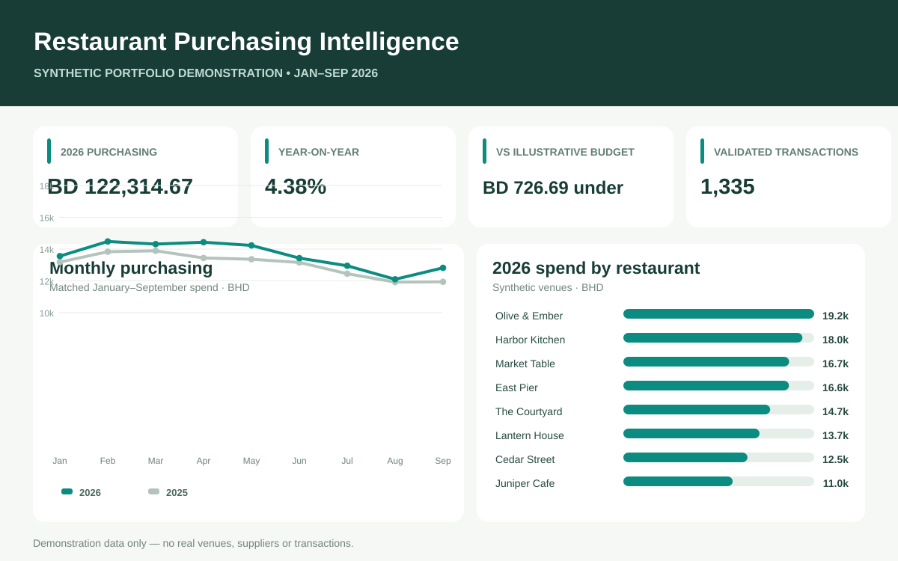

# Restaurant Purchasing Intelligence

**AI-assisted data cleaning, validation, purchasing analysis and interactive dashboard | Synthetic portfolio project**

> **Demonstration only:** Every venue, supplier, product, transaction and budget here is fictional. No employer records are included.

### Open the dashboard

- **[Interactive dashboard](https://hamadlehdan.github.io/restaurant-purchasing-analytics/)** — works once GitHub Pages is enabled for the `main` branch, `/ (root)`. If this link currently says 404, enable GitHub Pages under **Settings → Pages**.
- **[Dashboard source](index.html)** — self-contained, interactive HTML containing the fictional data and venue/product filters.
- **[Case study](CASE_STUDY.md)** — business question, approach, findings, recommendations and limitations.
- **[Tableau-ready dataset](02_cleaned_tableau_ready.csv)** — clean, validated invoice lines.
- **[Data-quality report](VALIDATION_REPORT.md)** — validation summary and rejected records.
- **[Data dictionary](DATA_DICTIONARY.md)** — field meanings.

### Business question

How could a multi-venue hospitality operator identify purchasing trends, supplier price differences, and potential areas to negotiate better value?

### Results — synthetic January–September 2026
- **BD 122,314.67** of purchasing, versus **BD 117,181.96** in the comparable 2025 period (**+4.38%**).
- **BD 726.69 below** an illustrative 2026 budget.
- **1,363 raw purchase lines** → 19 duplicate IDs removed and nine additional problematic rows quarantined → **1,335 validated records**.
- **172 documented data-cleaning adjustments** across supplier, venue, product, date and price fields.
- **BD 5,631.25 modeled price-only supplier-switch opportunity**, an illustrative scenario rather than a validated saving.

### Available source files

| File | Use |
| --- | --- |
| [01_raw_purchases.csv](01_raw_purchases.csv) | Original intentionally messy synthetic input |
| [02_cleaned_tableau_ready.csv](02_cleaned_tableau_ready.csv) | Validated and cleaned Tableau import |
| [03_quarantined_rows.csv](03_quarantined_rows.csv) | Invalid and duplicate records retained for audit |
| [04_cleaning_change_log.csv](04_cleaning_change_log.csv) | Field-level corrections |
| [05_budget_plan_2026.csv](05_budget_plan_2026.csv) | Illustrative purchasing budgets |
| [06_monthly_spend_by_supplier.csv](06_monthly_spend_by_supplier.csv) | Supplier and product summary |
| [07_monthly_comparison.csv](07_monthly_comparison.csv) | Comparable monthly spend |
| [index.html](index.html) | Self-contained interactive visual |
| [dashboard_preview.svg](dashboard_preview.svg) | Static chart preview shown above |

### Skills demonstrated

Data cleaning • data-quality checks • audit trails • Excel/CSV preparation • period-over-period comparison • budget variance • supplier price analysis • dashboard design • business recommendations.

### Tableau

Load `02_cleaned_tableau_ready.csv` into Tableau Public or Desktop. Set `order_date` to Date and the BHD amount columns to numeric. Build a monthly purchasing trend, venue breakdown and supplier benchmark. This repository provides an **HTML dashboard and Tableau-ready data**, not a published native Tableau workbook.

### Reproducibility and limitations

The complete local project package prepared separately also includes an Excel workbook, PDF case study, Python pipeline and Mac refresh script. Those local-only binary and script files are **not currently in this GitHub repository**. The GitHub-hosted visualization is self-contained and requires no Python runtime.

The supplier comparisons do not account for product quality, supplier capacity, contract terms, volume commitments or delivery conditions. A spending change can reflect changing quantities and mix, not just price.

**Portfolio purpose:** Demonstrate a transparent analysis workflow without suggesting the invented figures describe a real business.